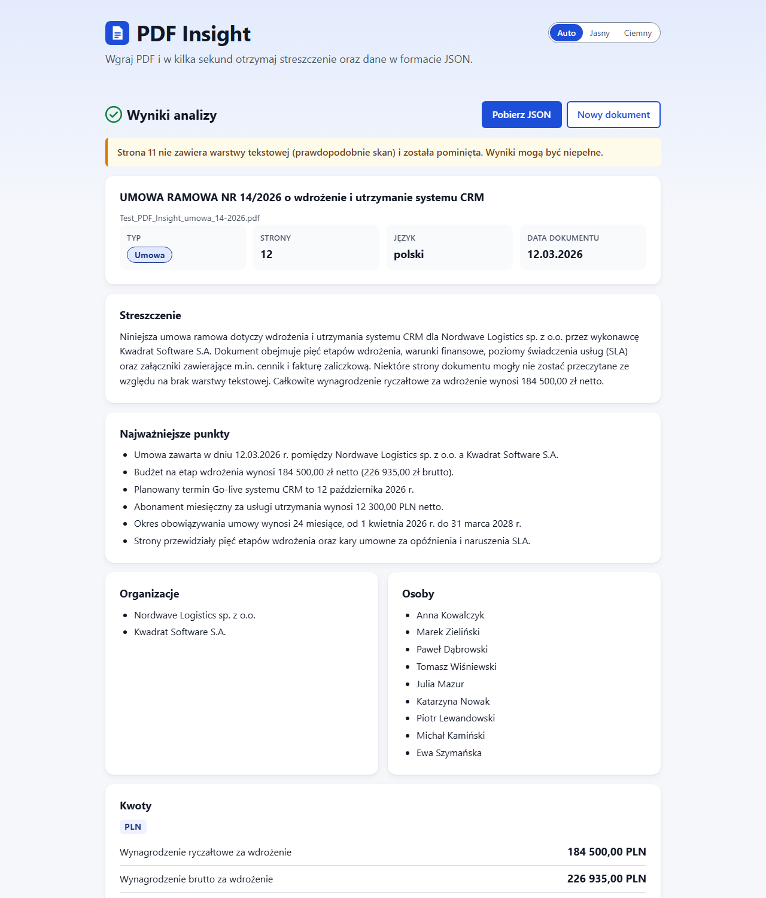
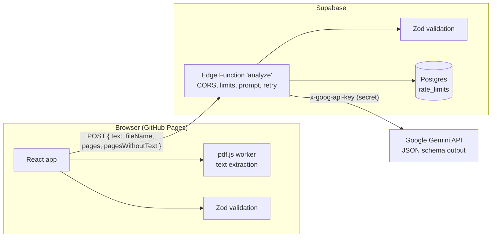

# PDF Insight

Upload a PDF, get a short summary and structured data as JSON, all in a few seconds. The UI is in
Polish; values stay in the document's language (a Polish contract gets Polish values, an English
one English values).

**Live demo: https://webmasterfed.github.io/pdf-insight/**



## What it does

1. **Upload** a PDF by drag and drop or the file picker (keyboard accessible). Only PDFs up to
   10 MB are accepted; the type is checked by the file's first bytes (`%PDF-`), not just its name.
2. **Extract** the text in the browser with pdf.js. Pages without a text layer (scans) are detected
   per page, skipped and listed in a warning; a PDF with no text at all gets a clear Polish message.
3. **Analyse** the text with Google Gemini through a Supabase Edge Function that holds the API key.
4. **Validate** the answer with the same Zod schema on the server and again in the browser.
5. **Show** the result: overview tiles (type, pages, language, date), summary, key points, people
   and organisations, amounts grouped by currency, a dates timeline, keywords and a JSON preview
   with a copy button. **Download** the JSON, named after the PDF.
6. **History**: the last 5 results are kept in this browser (localStorage) and can be reopened.

Also: loading state with real progress steps and a cancel button, error states with retry, light
and dark theme (automatic or chosen), responsive down to 360 px.

## Architecture



- **Only the extracted text** leaves the browser, never the PDF file itself.
- **Frontend**: React 19 + Vite + strict TypeScript, no router (single page). `src/components`
  (UI), `src/lib` (validation, extraction, formatting, history, theme), `src/api` (HTTP client).
- **Backend**: one Supabase Edge Function (Deno) in `supabase/functions/analyze`. The Zod schema
  and the API contract live in `supabase/functions/_shared` and are imported by both sides, so the
  browser and the server validate with exactly the same rules.
- **Database**: one table for shared rate-limit counters (`supabase/migrations`).
- **CI/CD**: GitHub Actions runs lint, typecheck, Deno check, tests and build, then deploys to
  GitHub Pages (only from `main`).

## Key decisions and tradeoffs

| Decision                                                 | Why                                                                                                                                                                                                                     |
| -------------------------------------------------------- | ----------------------------------------------------------------------------------------------------------------------------------------------------------------------------------------------------------------------- |
| Text extraction in the browser                           | The PDF never leaves the user's machine; only text is sent, which is far smaller than the file.                                                                                                                         |
| Supabase Edge Function as a proxy                        | The Gemini key must not be in the frontend. The function keeps it in Supabase secrets and adds CORS, limits and validation.                                                                                             |
| Gemini structured output **and** Zod                     | The JSON schema makes a valid shape likely; Zod makes it certain. On invalid output the server retries **exactly once** (sending the validation problems to the model), then returns `ai_invalid_response`.             |
| `gemini-3.5-flash-lite` (configurable via `LLM_MODEL`)   | Free tier, stable, 2–8 s per document. `gemini-3.8-flash` was tried first but thinks at "medium" by default and timed out after 25 s; switching was a secret change, not a code change.                                 |
| Schema enforces maximums, the prompt asks for minimums   | "3–5 sentences" and "3–7 key points" would force a one-line PDF to invent content, which breaks the "never guess" rule. So Zod enforces at most 5 sentences / 7 points / 20 amounts / 20 dates; the prompt asks for 3+. |
| `fileName` and `pages` are overwritten on the server     | The app knows the real values; the model is never trusted for them.                                                                                                                                                     |
| JWT verification off                                     | See security notes: the anon key would be public anyway.                                                                                                                                                                |
| Shared rate limiter in Postgres, in-memory as a fallback | Measured: in-memory counters never triggered because requests are spread over many instances.                                                                                                                           |

## Output schema

Keys in English, values in the document's language. Missing information is `null` or `[]`;
fields may be added, never removed (Zod `looseObject`).

```json
{
  "document": {
    "fileName": "umowa.pdf",
    "pages": 4,
    "language": "pl",
    "type": "umowa",
    "title": "Umowa serwisowa",
    "date": "2026-09-01"
  },
  "summary": "3 to 5 sentences",
  "keyPoints": ["3 to 7 items"],
  "entities": { "organizations": [], "people": [] },
  "amounts": [{ "value": 12500.0, "currency": "PLN", "context": "Wynagrodzenie netto" }],
  "dates": [{ "date": "2026-10-01", "context": "Termin płatności" }],
  "keywords": []
}
```

Rules checked by Zod (`supabase/functions/_shared/schema.ts`): `type` is one of
`faktura | umowa | oferta | raport | inne`; `language` is a 2-letter ISO 639-1 code or `null`;
dates are real ISO 8601 calendar dates (`2026-02-30` is rejected) or `null`; currencies must exist
in ISO 4217 (`Intl.supportedValuesOf('currency')`) or be `null`; at most 5 summary sentences,
7 key points, 20 amounts, 20 dates and 15 keywords.

## Security notes

- **API key only on the server.** The Gemini key is stored in Supabase secrets (`GEMINI_API_KEY`)
  and read by the Edge Function at runtime. It is never in the frontend bundle, in `.env.example` or
  in git history (checked with `npm run check-secrets:history`, which also runs before every commit).
- **CORS allowlist.** The function answers browsers only from exactly `https://webmasterfed.github.io`
  (scheme and host, no wildcard; hard-coded in `supabase/functions/analyze/cors.ts`). Local
  development origins (`http://localhost:<port>`, `http://127.0.0.1:<port>`) can be added only through
  the `DEV_ORIGINS` secret; any other value in it is ignored.
- **JWT verification is off** (`--no-verify-jwt`). With it on, the browser would have to send the
  Supabase anon key, which is public by design and visible in the JS bundle, so it would add no real
  protection. **CORS is not authentication** either: a script outside a browser can send any `Origin`
  header. The real protections are the rate limits, the size limits and server-side validation below.
- **Rate limits (shared, in Postgres).** 10 requests per 10 minutes per IP and 100 requests per hour
  in total; over the limit the API returns `429` with `Retry-After`. Counters live in the
  `rate_limits` table and are updated by the atomic `check_rate_limit()` SQL function
  (`supabase/migrations/`), because Edge Function requests are spread over many instances and
  in-memory counters never reached the limit (measured: 12 requests, 9 instances). RLS is enabled with
  no policies and only `service_role` may execute the function, so the public anon/publishable keys
  get "permission denied". IPs are stored only as SHA-256 hashes. If the database cannot be reached
  the function falls back to a per-instance in-memory limit, so the demo keeps working. The
  service-role key is injected by Supabase into the function environment and is never in git, the
  frontend or logs.
- **Size limits.** PDF max 10 MB (checked in the browser), request body max 1 MB and text max
  300 000 characters (checked on the server).
- **Prompt injection.** The PDF text is treated as data: it is wrapped in `<document-UUID>` markers
  with a fresh random UUID per request (so a document cannot fake the closing marker), and the
  system instruction tells the model never to follow instructions inside the document. The output
  must still pass Zod validation. Tested live with English and Polish injection text plus a fake
  `</document>` and `SYSTEM:` line: ignored.
- **No HTML from the model.** Everything is rendered as React text; there is no
  `dangerouslySetInnerHTML`.
- **Logs** contain error codes and Zod field paths only, never document text or keys.
- **Privacy notice** in the UI: the text is sent to an external AI API (Google Gemini); on the free
  tier Google may use submitted data to improve its services.

## Run locally

Requirements: Node.js 24, npm, a Supabase project and a Gemini API key (Google AI Studio).

### Frontend

```bash
npm ci
cp .env.example .env.local      # then set VITE_API_URL to your function URL
npm run dev                     # http://localhost:5173/pdf-insight/
```

### Edge Function

```bash
npx supabase@2.122.0 login
# The key is a secret: type it in your own terminal, never commit it.
npx supabase@2.122.0 secrets set GEMINI_API_KEY=<your key> --project-ref <ref>
npx supabase@2.122.0 secrets set LLM_MODEL=gemini-3.5-flash-lite DEV_ORIGINS=http://localhost:5173 --project-ref <ref>
npm run deploy:function         # deploys with --no-verify-jwt --use-api (no Docker needed)
```

Database: run the two files in `supabase/migrations/` (in order) in the Supabase SQL editor, or
`npx supabase db push` after `npx supabase link`. The production origin is hard-coded in
`supabase/functions/analyze/cors.ts`; change it if you deploy under another GitHub account.

### Environment variables (names only)

| Name                        | Where                                     | Secret? | Purpose                                                     |
| --------------------------- | ----------------------------------------- | ------- | ----------------------------------------------------------- |
| `VITE_API_URL`              | `.env.local`, GitHub Actions **variable** | No      | URL of the Edge Function, baked into the frontend build     |
| `GEMINI_API_KEY`            | Supabase secrets                          | **Yes** | Gemini API key                                              |
| `LLM_MODEL`                 | Supabase secrets                          | No      | Gemini model name, e.g. `gemini-3.5-flash-lite`             |
| `DEV_ORIGINS`               | Supabase secrets                          | No      | Optional extra CORS origins, only `localhost` / `127.0.0.1` |
| `SUPABASE_URL`              | injected by Supabase                      | No      | Used for the rate-limit RPC                                 |
| `SUPABASE_SERVICE_ROLE_KEY` | injected by Supabase                      | **Yes** | Used only server-side for the rate-limit RPC                |

## Tests and checks

```bash
npm run lint             # ESLint (strict type-checked rules, no any, no console.log) + Prettier
npm run typecheck        # tsc, strict mode
npm run check:function   # deno check of the Edge Function
npm test                 # Vitest: 105 tests in 14 files
npm run build
npm run check-secrets    # scans the staged diff; check-secrets:history scans all commits
```

The tests cover the schema (valid result, missing fields, wrong enum, null date, empty arrays,
extra fields, invalid currency, impossible dates, limits), the sentence counter, file validation,
per-page scan detection, the API client error mapping, CORS rules, both rate limiters, model output
parsing and the prompt's injection markers, formatting, history and theme storage.

## Known limitations

- **No chunking for very long documents (F-08 not implemented).** The whole text is sent in one
  request, capped at 300 000 characters (roughly 75–100k tokens, well inside the model's 1M-token
  context). Longer documents get a clear error instead of a partial analysis. The planned design was
  to split the text into overlapping chunks, analyse each and merge the results with a final
  consolidation call; it was left out to keep the required features solid.
- **Scanned pages are skipped, not read.** There is no OCR. Pages with fewer than 20 letters or
  digits are treated as having no text layer; they are listed in a warning and the model is told
  that the analysis is incomplete. A PDF where every page is a scan is rejected with a clear message.
- **Amount selection is not perfect.** The model is asked to list only the amounts that define the
  document (at most 20). With `gemini-3.5-flash-lite` it sometimes still includes the parties' share
  capital ("kapitał zakładowy") from the contract header; prompt and schema hints did not fix this.
- **Very short documents** get a 1–2 sentence summary (by design, see decisions); the model may
  occasionally over-read a single line.
- **Rate limits are per IP**, so users behind one shared IP share the limit. If the database is
  unreachable the limiter falls back to per-instance memory, which is not a hard guarantee.
- **CORS is not authentication** and JWT verification is off: anyone can call the API from a script
  by faking the `Origin` header, within the rate and size limits.
- **Free tier**: Gemini free-tier quotas apply (the API returns a Polish "service unavailable"
  message when they run out) and Google may use free-tier inputs to improve its services.
- **The sentence counter is a heuristic** (Polish and English abbreviations, legal forms); it is
  used only to enforce the maximum of 5 summary sentences.
- **Commit history**: commits `e7e0c25`, `6e10c24` and `388fc10` do not compile on their own (a
  commit-splitting mistake, fixed in `9c183f1`; details in `AI_LOG.md`).

## AI usage

This project was built with an AI pair programmer. See [AI_LOG.md](AI_LOG.md) for the tools, the key
prompts and every mistake the AI made and how it was fixed.
